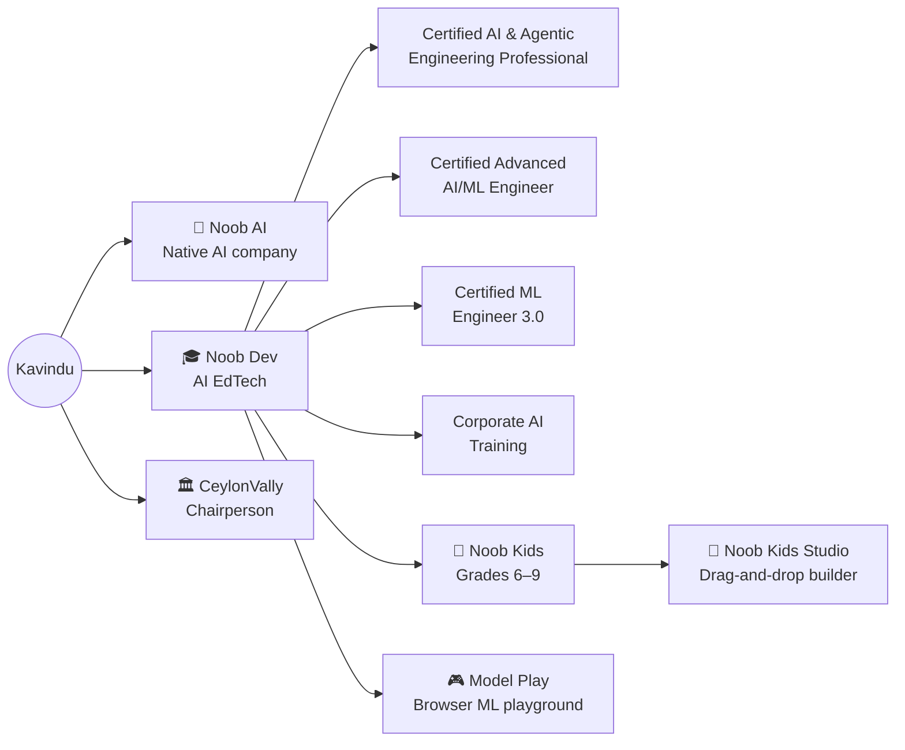

<!-- ═══════════════════════════ HEADER ═══════════════════════════ -->
<p align="center">
  
</p>

<p align="center">
  <a href="https://github.com/ImKavinduSandaruwan">
    
  </a>
</p>

<p align="center">
  <a href="http://www.linkedin.com/in/kavindu-sandaruwan-b897aa22b"></a>
  <a href="https://imkavindu.live/"></a>
  <a href="https://noobdevs.online"></a>
  <a href="mailto:kavinduy6p@gmail.com"></a>
  
</p>

---

### `> whoami`

```python
from agents import Agent

class KavinduSandaruwan(Agent):
    """Founder. Architect. Teacher. Builds AI systems that plan, use tools, and ship."""

    location = "Sri Lanka 🇱🇰"

    roles = {
        "Noob AI":     "CEO, Founder & Chief Solution Architect",  # native AI company
        "Noob Dev":    "CEO, Founder & Lead Instructor",           # AI-first EdTech
        "CeylonVally": "Chairperson",
    }

    education = [
        "MPhil — Artificial Intelligence & Data Science",
        "BEng (Hons) — Software Engineering, University of Westminster",
    ]

    tools = ["LLMs", "tool calling", "RAG", "multi-agent systems", "ML/DL", "MLOps", "full-stack"]

    def run(self, problem: str) -> str:
        plan = self.reason(problem)
        return self.act(plan, tools=self.tools)   # then teach 1,000 others how

    @property
    def mission(self):
        return "Build AI products in Sri Lanka — for the world."
```

---

### 🧠 What I Build

| | Area | Focus |
|---|---|---|
| 🤖 | **Agentic AI** | Tool-calling agents, multi-agent orchestration, memory, planning & evaluation |
| 📚 | **LLM Engineering** | RAG pipelines, prompt & context engineering, fine-tuning, guardrails |
| 📈 | **Machine Learning** | Classical ML → deep learning → production models with real data |
| 🏗️ | **Solution Architecture** | AI-native products end to end — backend, frontend, cloud, deployment |
| 🎓 | **AI Education** | Cohort programs turning students & professionals into AI engineers |

---

### 🌐 The Ecosystem I'm Building



---

### ⚡ Right Now

- 🤖 Teaching engineers to build **production-grade AI agents** — from a single tool call to multi-agent systems
- 🧪 Shipping **Model Play**, a browser-based platform to practise machine learning hands-on
- 🏢 Rolling out **AI training for companies** and their teams
- 🌱 Growing Noob Dev from a training company into a **product-led AI company**

---

### 🛠️ Stack

<p align="center">
  <br/>
  
</p>

<p align="center">
  
  
  
  
  
  
  
</p>

---

### 📊 GitHub Pulse

<p align="center">
  
  
</p>
<p align="center">
  
</p>
<p align="center">
  
</p>

---

### 🤝 Let's Talk

Building something with AI agents? Want your team trained in AI? Looking to collaborate in Sri Lanka's AI scene?
**Reach out — I reply to builders.**

> 💡 *"Old me: finish your project before the end of the world. Current me: build an agent that finishes it for you."*

<p align="center">
  
</p>
