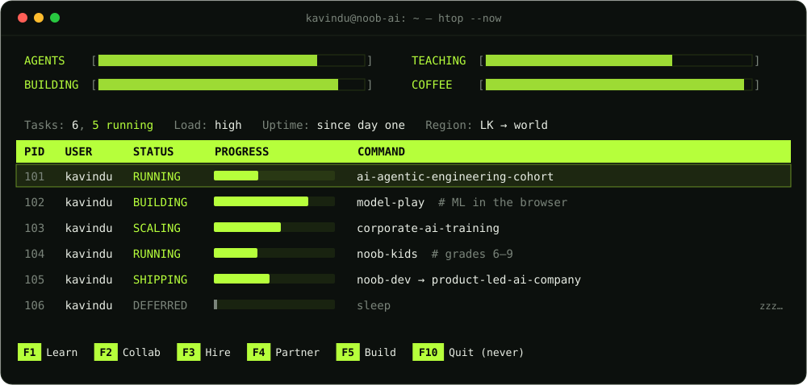
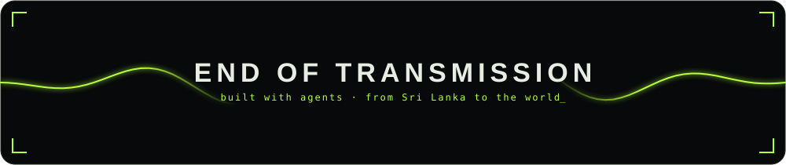

<!--
  ╔══════════════════════════════════════════════════════════════╗
  ║  KAVINDU SANDARUWAN · profile.v2                               ║
  ║  every animation below is hand-built SVG — no GIFs, no JS      ║
  ╚══════════════════════════════════════════════════════════════╝
-->

<a href="https://imkavindu.live/">
  
</a>

<p align="center">
  <a href="http://www.linkedin.com/in/kavindu-sandaruwan-b897aa22b"></a>
  <a href="https://imkavindu.live/"></a>
  <a href="https://noobdevs.online"></a>
  <a href="mailto:kavinduy6p@gmail.com"></a>
  
</p>







<br/>



<br/>




<h3 align="center"><code>~/stack</code></h3>

<p align="center">
  <br/>
  
</p>

<p align="center">
  
  
  
  
  
  
  
</p>


<h3 align="center"><code>~/telemetry</code></h3>

<p align="center">
  
  
</p>

<p align="center">
  
</p>

<p align="center">
  
</p>

<!-- Lime contribution snake — generated daily by .github/workflows/snake.yml -->
<p align="center">
  
</p>

<details>
<summary><b><code>▶ $ python -c "import kavindu; kavindu.run()"</code></b>  ← click to execute</summary>
<br/>

```text
[boot]    loading weights ............................ ok
[agent]   tools: llm, rag, code, teach, ship ......... 5 registered
[agent]   memory: Sri Lanka 🇱🇰 → world ............... mounted
[plan]    1. find a real problem
          2. build the smallest agent that solves it
          3. teach 1,000 people to build the next one
          4. repeat
[status]  you found the easter egg. let's build something → kavinduy6p@gmail.com
```

</details>


